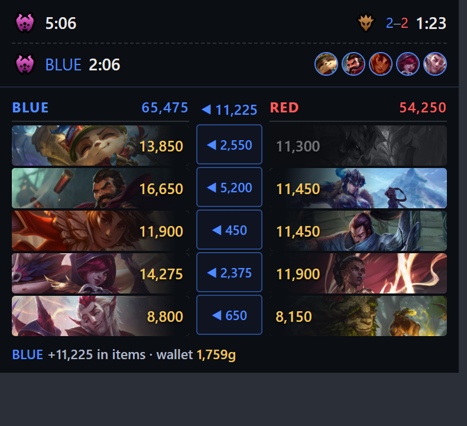

# live_overlay

Overlay de partida en vivo para League of Legends: dos ventanitas
translúcidas, siempre encima, que enseñan lo que el cliente del juego ya
expone en local pero no muestra bien. Sin modelo, sin clave de Riot, sin base
de datos.

Proyecto hermano de `../build_tracker` (asesor de tienda) y `../macro_coach`
(macro de jungla). Comparten dueño y dominio, pero **no comparten código ni
datos**: los overlays de partida son cosa aparte del modelo.

## Qué enseña (v0.2)

- **Objetivos** (ventana pequeña): icono de Barón y de dragón con su cuenta
  atrás de respawn o `UP`, el marcador de dragones (azul–rojo), y debajo cada
  buff de Barón o Elder activo con su tiempo restante y los iconos de quién
  lo lleva (los vivos del equipo que lo mató; se quitan al morir). Solo en la
  Grieta del Invocador; en ARAM o Arena la ventana lo dice.
- **Oro de objetos** (ventana ancha): dos columnas BLUE / RED de cinco filas,
  con el total de objetos por equipo y, en cada fila, un rectángulo del splash
  del campeón (el que tú marcas en `/faces`, el mismo para las dos columnas)
  fundiéndose en negro conforme llega a la cifra. En BLUE la cifra va a la
  derecha; en RED a la izquierda, con el fundido al revés. Las filas van por
  línea (top, jungla, mid, bot, support) cuando el API da posiciones, y entre
  las dos columnas hay un cuadro por línea con la diferencia de oro de objetos
  y una flecha hacia el ganador: azul si gana BLUE, roja si gana RED, blanca
  y sin flecha si es 0; el cuadro de arriba es la diferencia de equipo. El
  oro sin gastar de los demás no existe en el API y no se inventa; el tuyo lo
  da el API pero no se muestra, por decisión del owner.
- **Translúcidas en reposo, opacas con Tab**: mientras mantienes pulsada la
  tecla del marcador las dos ventanas se vuelven sólidas. Solo se lee el
  estado de la tecla; nunca se inyecta entrada.
- Se arrastran con el ratón, ajustan su alto al contenido, recuerdan dónde
  las dejaste (`data/layout.json`) y la ✕ de cualquiera cierra las dos.
- **Marca de cada campeón**: la fila necesita saber qué rectángulo del splash
  enseñar. Abre http://127.0.0.1:8020/faces: a la izquierda está la lista
  completa de campeones de la A a la Z (con filtro, ✓ en los ya marcados, los
  de la partida en curso señalados) y a la derecha el splash del seleccionado
  con un rectángulo de la proporción de la fila: arrástralo sobre el
  personaje, cambia su tamaño con la rueda o el deslizador, afínalo con las
  flechas, y mira las filas BLUE y RED previsualizadas a 3x. Enter guarda,
  AvPág y RePág pasan de campeón, y una casilla salta los ya marcados. Se
  guarda en `config/faces.json` (versionado) como centro y anchura del
  rectángulo, y el overlay lo aplica en menos de 10 s. Sin marca se asume un
  rectángulo centrado que ocupa la mitad del ancho.
- **Splash propio**: si prefieres otro arte para un campeón, deja un
  `<id>.jpg` en `config/splashes/` (proporción 1215:717, cualquier tamaño) y
  el overlay lo usa en vez del descargado; la marca del rectángulo vale igual
  porque se guarda en fracciones. Fiddlesticks ya viene así.

Todo sale del Live Client Data API (`https://127.0.0.1:2999`), el endpoint
local sancionado por Riot que usan Blitz o Porofessor. No se lee memoria ni
se raspa la pantalla. Iconos de campeón: Data Dragon; splashes: CommunityDragon (el arte actual del cliente, porque el splash sin versión de Data Dragon se queda viejo tras un rework, como Fiddlesticks); iconos de
Barón y dragones: CommunityDragon (espejo comunitario de los assets). Todo se
cachea en `data/cache/` tras la primera descarga. Lo que el API no da
(campamentos, daño, cooldowns de aliados) no está; `docs/design.md` explica
por qué.

## Ejemplo



Partida CLASSIC grabada el 3 de septiembre de 2026, minuto 32, reproducida por el panel
a 2× de zoom: arriba objetivos (Barón reaparece en 5:06, dragones 2–2 y el siguiente en
1:23, buff de Barón de BLUE con 2:06 y sus cinco portadores) y abajo el oro por línea con
los cuadros de diferencia. (Captura anterior a quitar la línea de pie.)

## Arrancar

Requisitos: Python 3.14 (el mismo que los hermanos), Windows 11 (Windows 10
vale, sin esquinas redondeadas), League en modo **Sin bordes** o Ventana
(sobre pantalla completa exclusiva no se puede dibujar).

```bat
py -3.14 -m venv .venv
.venv\Scripts\python.exe -m pip install -r requirements.txt
start_overlay.bat
```

`start_overlay.bat` arranca el servidor local (puerto 8020) si no está y
abre las dos ventanas arriba a la derecha. Una sola instancia por sesión:
pulsarlo dos veces no abre cuatro ventanas. Cerrar las ventanas con la ✕ deja
el servidor en marcha a propósito, para que la página de marcas siga
funcionando sin el overlay; `stop_overlay.bat` lo para del todo. Cualquier error del arranque
queda en `data/overlay.log` (y el del servidor en `data/server.err`), porque
`pythonw` no tiene consola. También vale abrir http://127.0.0.1:8020/ en un
navegador o segundo monitor: ahí salen las dos tarjetas juntas.

La primera vez descarga `item.json` y `champion.json` de Data Dragon a
`data/cache/`, en segundo plano: ningún poll espera a la red. Sin red usa la
versión cacheada más nueva; sin red y sin caché los valores salen del coste
base del API y se marcan con `≈`, y los campeones sin icono muestran sus
iniciales.

## Grabar y reproducir partidas

```bat
.venv\Scripts\python.exe scripts\record.py
.venv\Scripts\python.exe scripts\replay.py --dir data\snapshots [--from snap_....json]
```

`record.py` guarda un snapshot cada 2 s mientras juegas. `replay.py` sirve el
panel en el puerto 8021 reproduciendo esos ficheros a ritmo real desde que
el panel se conecta, para ver el overlay sin abrir League.

## Tests

```bat
.venv\Scripts\python.exe scripts\run_tests.py
```

## Dónde está cada cosa

`app/tracker.py` es el núcleo (snapshot → payload del panel). `app/ddragon.py`
el catálogo de objetos y campeones. `app/live_client.py` la lectura del API.
`app/main.py` el servidor y la caché de imágenes. `app/overlay.py` las
ventanas (capas de Win32, tecla Tab, posiciones). `web/overlay.html` el
panel. `docs/design.md` qué da el API, de dónde sale cada constante y qué se
descartó. `docs/history.md` las trampas encontradas.
